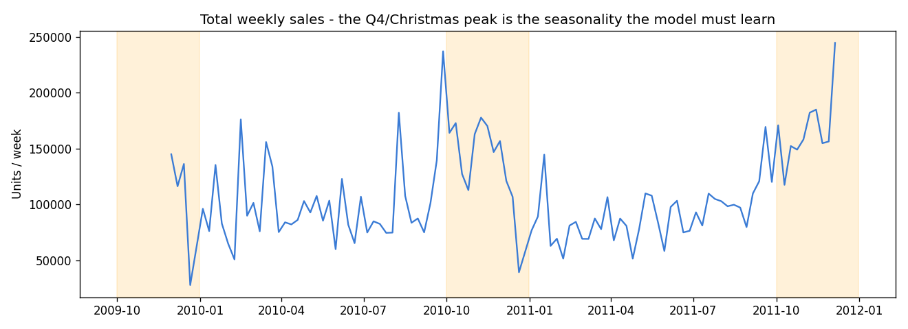

# E-commerce Sales Analytics & LSTM Forecasting

A Python e-commerce sales analytics project that processes over one million retail transactions through data cleaning, product-level aggregation, exploratory analysis, visualization, and LSTM demand forecasting.

**Focus:** data cleaning and preparation · exploratory data analysis · data visualization · LSTM forecasting.



## What this project demonstrates

| Area | Implementation |
| --- | --- |
| Data cleaning | Combine two Excel sheets, remove duplicates and cancellations, validate quantities and prices, and filter non-product codes with regular expressions. |
| Data preparation | Aggregate transactions by product and week, fill missing sales periods, rank products by training-period revenue, and filter sparse series. |
| Exploratory analysis | Analyze weekly sales, Christmas seasonality, revenue by market, monthly performance, product rankings, and price versus volume. |
| Visualization | Interactive charts, a sortable and searchable product table, CSV export, and actual-versus-predicted sales charts. |
| Forecasting | Train one stacked LSTM across 20 products using a 12-week history window, calendar features, and product embeddings to predict the next four weeks. |
| Evaluation | Compare LSTM with AutoARIMA, historical average, last-value, and seasonal-naive forecasts on the same rolling test windows. |
| BI reporting | Use Power BI, Power Query, a fact/dimension model, and DAX to build a sales report with KPI cards, product rankings, and interactive filtering. |

## Data pipeline

```text
Online Retail II (Excel)
    -> data cleaning and transaction validation
       |-> exploratory analysis -> sales, market, product, and price visualizations
       |-> weekly product series -> LSTM forecasts -> forecast charts and scenarios
       `-> Power BI tables -> DAX metrics -> interactive sales report
```

The original run processes **1,067,371 transaction rows**, removes **34,335 exact duplicates**, and retains **1,003,213 rows** after cleaning. Forecasting uses **20 products across 104 complete weeks**. Product selection and scaling use the training period; the most recent **26 weeks** are held out for evaluation.

## Technology

- **Analysis and preparation:** Python, pandas, NumPy, regular expressions, OpenPyXL, Parquet.
- **Visualization:** Matplotlib for analysis figures and Recharts for interactive charts.
- **Forecasting:** TensorFlow/Keras LSTM; StatsForecast for AutoARIMA and baseline comparisons.
- **Business intelligence reporting:** Power BI Desktop, Power Query, DAX, fact and dimension modeling, interactive report filtering.
- **Demo application:** React, Flask REST API, and SQLite for local demo accounts.

## Dashboard examples


### Revenue and market analysis


### Forecasts against held-out actual sales


The web dashboard also includes price-volume exploration and inventory scenarios using simulated stock and elasticity-based demand adjustments.

## Power BI reporting module

The project also includes a [Power BI sales report](powerbi/Ecommerce%20Sales%20Analytics.pbix) built from the cleaned transaction data. It demonstrates Power Query data preparation, fact and dimension modeling, DAX measures, KPI cards, monthly trends, country analysis, Top 10 products, and date-range filtering.

The saved report includes its imported data and semantic model. See the [module documentation](powerbi/README.md), [DAX formulas](powerbi/measures.dax), and [report definitions](powerbi/report-definition/) for the implementation and refresh steps.

## Run the local demo

Use Python 3.11–3.13 and Node.js 18 or later with npm. Run commands from the repository root.

```bash
python -m venv .venv
# Windows PowerShell: .venv\Scripts\Activate.ps1
# macOS/Linux: source .venv/bin/activate
pip install -r requirements.txt
npm --prefix frontend ci
python scripts/prepare_demo.py
```

The preparation script copies the bundled aggregate data and trained model into the ignored `data/processed/` directory. No raw transaction download or model training is needed for the demo.

Start the API and dashboard in separate terminals:

```bash
python -m src.backend.app
```

```bash
npm --prefix frontend run dev
```

Open **http://localhost:5173**. The local demo account is **admin / admin123**. The app creates its local account database on first use. Deployment configuration uses `FYP_SECRET_KEY` and `FYP_ADMIN_CODE`; configure these and replace the demo credentials for a hosted instance.

On the prediction page, choose a bundled example or upload a CSV from `data/processed/examples/`:

- **Validation:** held-out historical weeks with actual sales displayed.
- **Future:** the weeks after the recorded dataset, with no observed outcomes.

Forecast inputs use consecutive weekly history for one of the 20 supported products. Runtime forecasting loads the saved model and performs inference.

## Explore the code

| Path | Purpose |
| --- | --- |
| [`src/data/adapter.py`](src/data/adapter.py) | Cleaning, validation, product selection, weekly aggregation, and gap filling. |
| [`src/data/eda_aggregates.py`](src/data/eda_aggregates.py) | Revenue, market, month, and product summaries for the dashboard. |
| [`src/predictive/features.py`](src/predictive/features.py) | Shared calendar features and model history length. |
| [`src/predictive/lstm_global.py`](src/predictive/lstm_global.py) | Window preparation, stacked LSTM training, uncertainty, and evaluation. |
| [`src/predictive/baselines.py`](src/predictive/baselines.py) | Baseline forecasting on rolling test windows. |
| [`frontend/src/pages/Dashboard.jsx`](frontend/src/pages/Dashboard.jsx) | Interactive exploratory analysis. |
| [`frontend/src/pages/Predict.jsx`](frontend/src/pages/Predict.jsx) | Forecast visualization and scenarios. |
| [`powerbi/`](powerbi/) | Power BI reporting module, DAX measures, report definitions, and data preparation script. |
| `src/prescriptive/` | Supporting inventory rules and scenario calculations. |
| `demo/processed/` | Small aggregate demo datasets, example inputs, and saved model artifacts. |
| `results/` | Selected analysis figures and recorded model comparison. |

## Reproduce the offline pipeline

Download the Excel workbook from [UCI Online Retail II](https://archive.ics.uci.edu/dataset/502/online+retail+ii), and place it at `data/raw/online_retail_II.xlsx`. Then run:

```bash
python -m src.data.adapter
python -m src.predictive.baselines
python -m src.predictive.lstm_global
python -m src.prescriptive.elasticity
python -m src.data.eda_aggregates
python -m src.data.make_examples
```

The saved comparison in [`results/comparison_models.csv`](results/comparison_models.csv) records LSTM RMSE **363.38** and AutoARIMA RMSE **366.67**; their MAE values are **202.23** and **186.95**, respectively.

The LSTM uses Monte Carlo Dropout and a validation-residual adjustment to produce forecast bands.

## Data attribution

Chen, D. (2012). *Online Retail II* [Dataset]. UCI Machine Learning Repository. [DOI: 10.24432/C5CG6D](https://doi.org/10.24432/C5CG6D).

The source dataset is distributed under [CC BY 4.0](https://creativecommons.org/licenses/by/4.0/). The Power BI report contains cleaned transaction data derived from this public dataset. The Python demo bundle contains aggregated product/week data and model artifacts. See [`powerbi/README.md`](powerbi/README.md) and [`demo/README.md`](demo/README.md) for the transformations.
