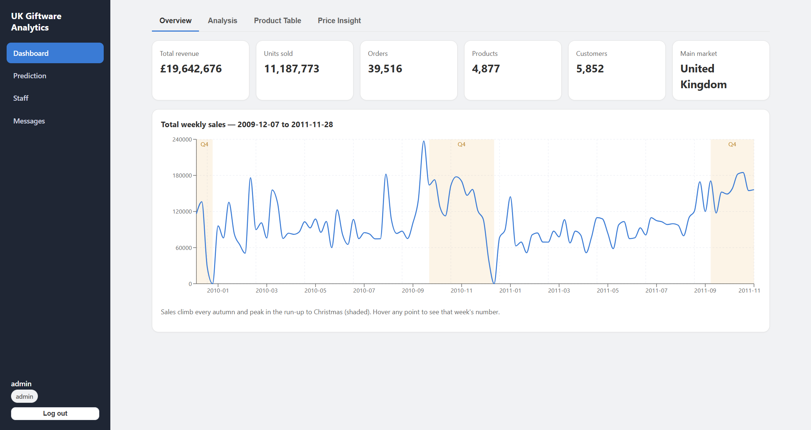
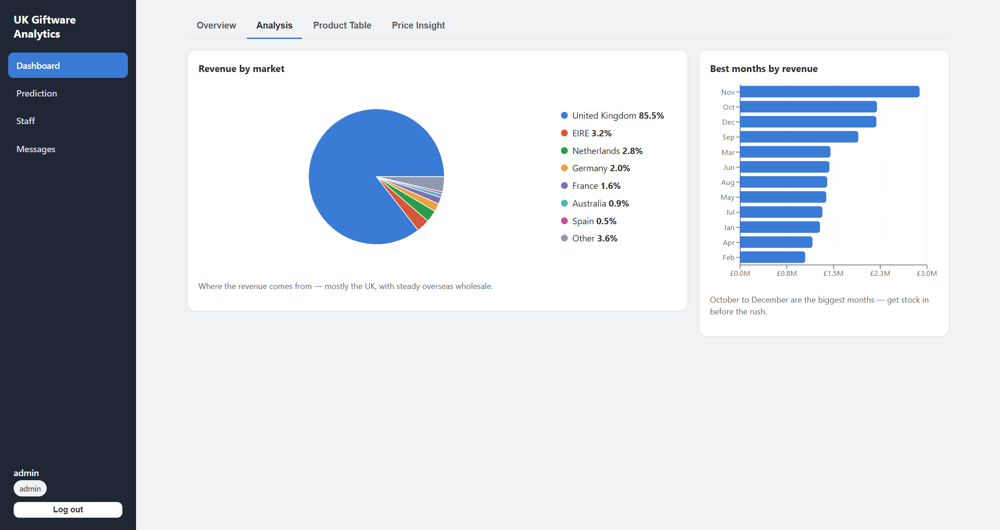
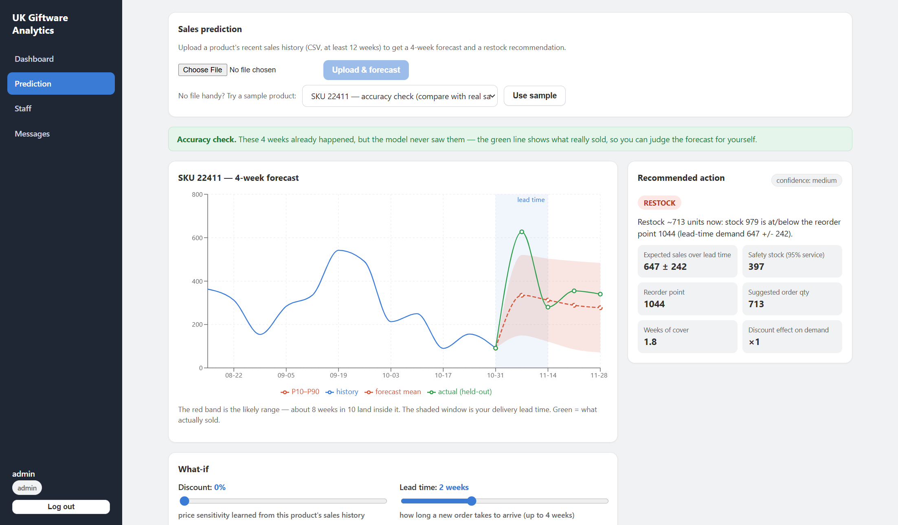

# E-commerce Sales Analytics & LSTM Forecasting

A Python data analytics project that turns over one million retail transaction records into cleaned weekly sales data, interactive business insights, and four-week product demand forecasts.

**Focus:** data cleaning · exploratory data analysis · time-series preparation · data visualization · LSTM forecasting.



## What this project demonstrates

| Area | Implementation |
| --- | --- |
| Data cleaning | Combine two Excel sheets, remove duplicates and cancellations, validate quantities and prices, and filter non-product codes with regular expressions. |
| Data preparation | Aggregate transactions by product and week, fill missing sales periods, rank products by training-period revenue, and filter sparse series. |
| Exploratory analysis | Analyze weekly sales, Christmas seasonality, revenue by market, monthly performance, product rankings, and price versus volume. |
| Visualization | Interactive charts, a sortable and searchable product table, CSV export, and actual-versus-predicted sales charts. |
| Forecasting | Train one stacked LSTM across 20 products using a 12-week history window, calendar features, and product embeddings to predict the next four weeks. |
| Evaluation | Compare LSTM with AutoARIMA, historical average, last-value, and seasonal-naive forecasts on the same rolling test windows. |

The source dataset has **no product categories**. Product grouping uses stock codes; this project does not claim a product-category classification model.

## Data pipeline

```text
Online Retail II (Excel)
    -> deduplication and transaction validation
    -> product filtering and weekly aggregation
    -> exploratory analysis and dashboard summaries
    -> time-series windows and LSTM forecasts
    -> interactive charts and inventory what-if scenarios
```

The original run processes **1,067,371 transaction rows**, removes **34,335 exact duplicates**, and retains **1,003,213 rows** after cleaning. Forecasting uses **20 products across 104 complete weeks**. Product selection and scaling use the training period; the most recent **26 weeks** are held out for evaluation.

## Technology

- **Analysis and preparation:** Python, pandas, NumPy, regular expressions, OpenPyXL, Parquet.
- **Visualization:** Matplotlib for offline figures; Recharts for interactive charts.
- **Forecasting:** TensorFlow/Keras LSTM; StatsForecast for AutoARIMA and baseline comparisons.
- **Demo application:** React, Flask REST API, and SQLite for local demo accounts.

## Dashboard examples

### Revenue and market analysis



### Forecasts against held-out actual sales



The dashboard also includes price-volume exploration and inventory scenarios. Inventory is **simulated**, because the source dataset contains no stock records. Discount responses use an estimated or assumed elasticity; they are exploratory scenarios, not causal estimates from the LSTM.

## Run the local demo

Use Python 3.11–3.13 and Node.js 18 or later with npm. Run commands from the repository root.

```bash
python -m venv .venv
# Windows PowerShell: .venv\Scripts\Activate.ps1
# macOS/Linux: source .venv/bin/activate
pip install -r requirements.txt
npm --prefix frontend ci
python scripts/prepare_demo.py
```

The preparation script copies the bundled aggregate data and trained model into the ignored `data/processed/` directory. No raw transaction download or model training is needed for the demo.

Start the API and dashboard in separate terminals:

```bash
python -m src.backend.app
```

```bash
npm --prefix frontend run dev
```

Open **http://localhost:5173**. The local demo account is **admin / admin123**. These are public demo credentials, not production credentials. The app seeds a new local account database on first use; no existing account database is included. Keep this demonstration local. For any later deployment, replace the demo credentials and configure `FYP_SECRET_KEY` and `FYP_ADMIN_CODE`.

On the prediction page, choose a bundled example or upload a CSV from `data/processed/examples/`:

- **Validation:** held-out historical weeks with actual sales displayed.
- **Future:** the weeks after the recorded dataset, with no observed outcomes.

Uploads must contain one known product's consecutive weekly history in the supplied format. The model does not support arbitrary datasets or unseen products. Runtime forecasting uses the saved model; it does not train on uploaded data.

## Explore the code

| Path | Purpose |
| --- | --- |
| [`src/data/adapter.py`](src/data/adapter.py) | Cleaning, validation, product selection, weekly aggregation, and gap filling. |
| [`src/data/eda_aggregates.py`](src/data/eda_aggregates.py) | Revenue, market, month, and product summaries for the dashboard. |
| [`src/predictive/features.py`](src/predictive/features.py) | Shared calendar features and model history length. |
| [`src/predictive/lstm_global.py`](src/predictive/lstm_global.py) | Window preparation, stacked LSTM training, uncertainty, and evaluation. |
| [`src/predictive/baselines.py`](src/predictive/baselines.py) | Baseline forecasting on rolling test windows. |
| [`frontend/src/pages/Dashboard.jsx`](frontend/src/pages/Dashboard.jsx) | Interactive exploratory analysis. |
| [`frontend/src/pages/Predict.jsx`](frontend/src/pages/Predict.jsx) | Forecast visualization and scenarios. |
| `src/prescriptive/` | Supporting inventory rules and scenario calculations. |
| `demo/processed/` | Small aggregate demo datasets, example inputs, and saved model artifacts. |
| `results/` | Selected analysis figures and recorded model comparison. |

## Reproduce the offline pipeline

Download the Excel workbook from [UCI Online Retail II](https://archive.ics.uci.edu/dataset/502/online+retail+ii), and place it at `data/raw/online_retail_II.xlsx`. Then run:

```bash
python -m src.data.adapter
python -m src.predictive.baselines
python -m src.predictive.lstm_global
python -m src.prescriptive.elasticity
python -m src.data.eda_aggregates
python -m src.data.make_examples
```

Training time and results depend on the environment. The saved comparison in [`results/comparison_models.csv`](results/comparison_models.csv) comes from the original experiment: LSTM RMSE **363.38** and AutoARIMA RMSE **366.67**, while AutoARIMA has lower MAE (**186.95** versus **202.23**). The comparison does not establish consistent LSTM superiority.

The LSTM includes Monte Carlo Dropout and a validation-residual adjustment for forecast bands. This is an implementation of existing methods, not a claim of a new forecasting algorithm.

## Data attribution

Chen, D. (2012). *Online Retail II* [Dataset]. UCI Machine Learning Repository. [DOI: 10.24432/C5CG6D](https://doi.org/10.24432/C5CG6D).

The source dataset is distributed under [CC BY 4.0](https://creativecommons.org/licenses/by/4.0/). Bundled data are cleaned and aggregated derivatives; they contain product/week summaries, not individual customer or invoice records. See [`demo/README.md`](demo/README.md) for the transformations and artifact details.
