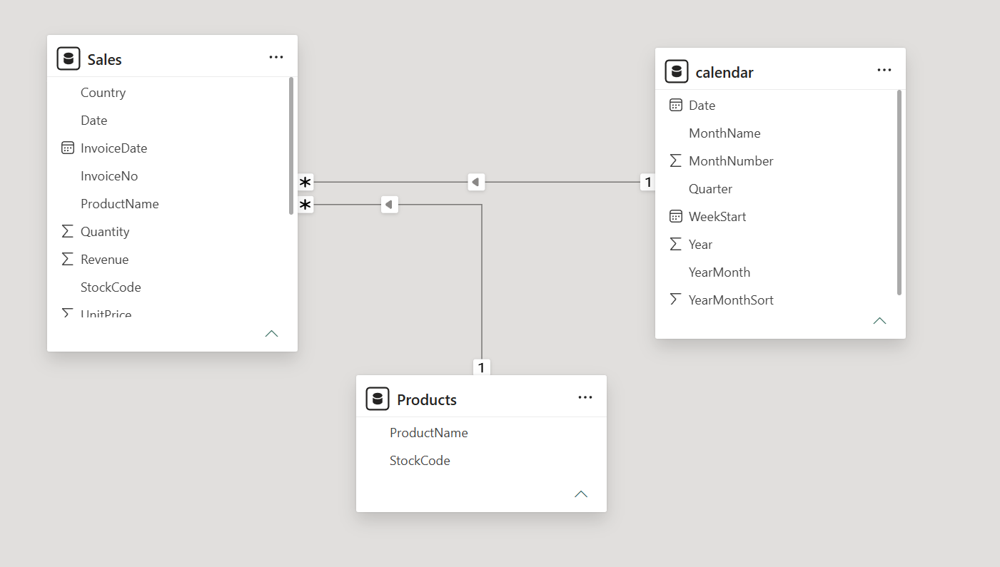

# Power BI Sales Analytics

[Download the report](Ecommerce%20Sales%20Analytics.pbix) and open it in Power BI Desktop.

The report covers data processing, sales analysis, dimensional modeling, DAX metrics, and interactive visualization across **1,003,213 cleaned transaction lines** from Online Retail II.

This module presents business intelligence reporting within the broader project's data analysis, visualization, and LSTM forecasting workflow.

## Report features

| Component | Analysis |
| --- | --- |
| KPI cards | Revenue, orders, average order value, and units sold. |
| Monthly trend | Revenue by calendar month. |
| Country analysis | Revenue by market, sorted in descending order. |
| Product ranking | Top 10 products by revenue with product-name tooltips. |
| Date slicer | Filter the report to a selected date range. |
| Visual interactions | Select a market or product to explore its contribution across the report. |
| Transaction count | Reconcile imported records with the prepared dataset. |

## Skills and tools

- **Power BI Desktop:** report creation, visual configuration, formatting, and cross-filtering.
- **Power Query:** CSV import, header promotion, field types, and date/currency handling.
- **Data modeling:** sales fact table, product and calendar dimensions, active one-to-many relationships, and single-direction filtering.
- **DAX:** aggregations, distinct counts, division, and row counts.
- **Python/pandas:** transaction cleaning, product-key normalization, dimension preparation, and reconciliation of exported data.

## Data model

| Full-period metric | Value |
| --- | ---: |
| Revenue | £19,642,676.02 |
| Units sold | 11,187,773 |
| Orders | 39,516 |
| Average order value | £497.08 |
| Products | 4,707 |



| Dimension | Sales key | Relationship |
| --- | --- | --- |
| `calendar[Date]` | `Sales[Date]` | One-to-many; calendar filters Sales. |
| `Products[StockCode]` | `Sales[StockCode]` | One-to-many; Products filters Sales. |

The calendar covers 2009–2011, with date, year, quarter, month, month sort, and Monday week-start columns. Monthly labels sort by `YearMonthSort`; month names sort by `MonthNumber`.

Product codes are standardized to uppercase before preparing the Power BI dimensions. This resolves 170 case-only duplicate keys and produces **4,707 product keys** from 4,877 original code spellings. All sales transaction lines are retained.

## DAX measures

The formulas are available in [`measures.dax`](measures.dax).

```dax
Total Revenue = SUM(Sales[Revenue])
Total Units = SUM(Sales[Quantity])
Total Orders = DISTINCTCOUNT(Sales[InvoiceNo])
Products Sold = DISTINCTCOUNT(Sales[StockCode])
Average Order Value = DIVIDE([Total Revenue], [Total Orders])
Transaction Rows = COUNTROWS(Sales)
```

Order count uses distinct invoice numbers because an order can contain multiple product lines. Revenue uses quantity multiplied by the original transaction price. Revenue and average order value display as GBP with two decimal places.

## Data preparation and refresh

The `.pbix` includes its imported data, so it can be opened and explored immediately. To regenerate the CSV sources for refresh:

1. Install the repository's Python dependencies: `pip install -r requirements.txt`.
2. Run `python scripts/prepare_demo.py` to prepare the existing dashboard aggregates used for reconciliation.
3. Download [Online Retail II from UCI](https://archive.ics.uci.edu/dataset/502/online+retail+ii) and place the workbook at `data/raw/online_retail_II.xlsx`.
4. Run `python powerbi/export_data.py` from the repository root.
5. In Power BI Desktop, use **Transform data > Data source settings > Change source** to point each CSV source at the corresponding generated file on your machine, then refresh.

The script exports:

| File | Contents |
| --- | --- |
| `data/powerbi/sales_cleaned.csv` | Sales transaction fact table, with normalized product keys and names. |
| `data/powerbi/products.csv` | Unique product codes and descriptive names. |
| `data/powerbi/calendar.csv` | Continuous date dimension covering complete calendar years. |
| `data/powerbi/expected_totals.json` | Revenue, units, orders, product count, transaction count, and date bounds. |

Cleaning combines both Excel sheets, removes exact duplicates, cancellations, non-positive quantities/prices, and non-product codes. Export validation reconciles row counts, units, orders, and revenue against the recorded whole-shop analytics.

## Report files

- [`Ecommerce Sales Analytics.pbix`](Ecommerce%20Sales%20Analytics.pbix): saved report and imported semantic model.
- [`report-definition/`](report-definition/): extracted JSON definitions for the report pages, visuals, field bindings, filters, sorting, and formatting.
- [`export_data.py`](export_data.py): reproducible data preparation.
- [`measures.dax`](measures.dax): report metrics.

## Dataset attribution

Chen, D. (2012). *Online Retail II* [Dataset]. UCI Machine Learning Repository. [DOI: 10.24432/C5CG6D](https://doi.org/10.24432/C5CG6D). Licensed under [CC BY 4.0](https://creativecommons.org/licenses/by/4.0/).

The report data are transformed derivatives: cleaned positive sales transactions, normalized product codes, product descriptions, and calendar attributes. Coverage: **2009-12-01 to 2011-12-09**; transaction prices and revenue are in GBP.
